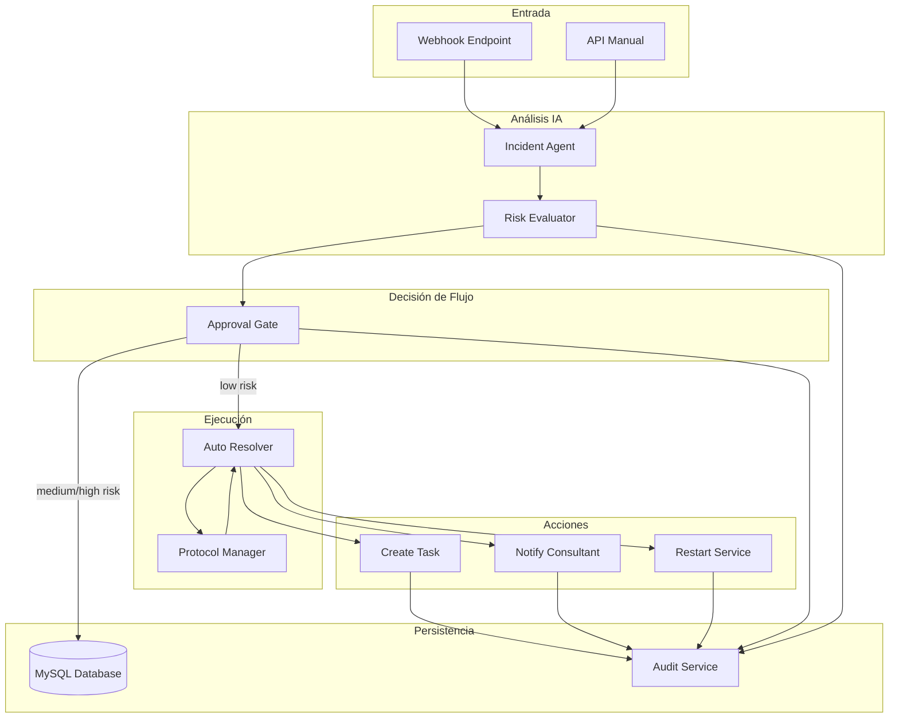
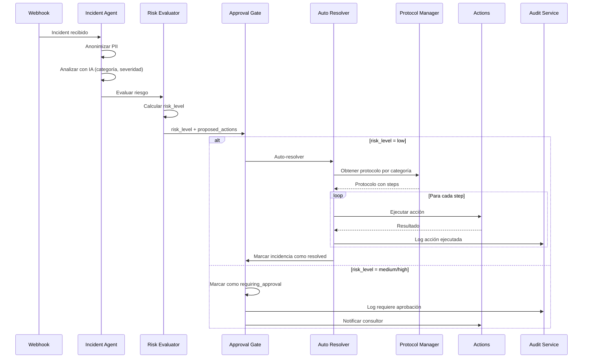

# Documento de Diseño Técnico

## Visión General

### Propósito

El sistema de resolución automática de incidencias (Auto-Resolution System) extiende el sistema IncidentFlow AI existente para permitir la resolución automática de incidencias de bajo riesgo basándose en protocolos predefinidos. El sistema añade capacidades de evaluación de riesgo, ejecución automatizada de resoluciones, y una puerta de aprobación mejorada para incidencias de mayor riesgo.

### Objetivos

1. **Automatización inteligente**: Resolver automáticamente incidencias de bajo riesgo siguiendo protocolos predefinidos, reduciendo el tiempo de respuesta y la carga de trabajo manual
2. **Seguridad controlada**: Requerir aprobación humana obligatoria para incidencias de riesgo medio o alto antes de ejecutar cualquier acción
3. **Trazabilidad completa**: Mantener un registro de auditoría inmutable de todas las acciones ejecutadas para cumplimiento regulatorio
4. **Gestión flexible**: Permitir la definición y actualización de protocolos de resolución sin modificar código

### Alcance

**Incluido en este diseño:**
- Evaluador de riesgo (Risk Evaluator) que clasifica incidencias en niveles low/medium/high
- Motor de auto-resolución (Auto Resolver) que ejecuta protocolos para incidencias de bajo riesgo
- Puerta de aprobación mejorada (Approval Gate) para incidencias de riesgo medio/alto
- Sistema de gestión de protocolos con almacenamiento, validación y recuperación
- Parser y serializador de protocolos con soporte round-trip
- Extensión del sistema de auditoría para registrar ejecuciones automatizadas
- Nuevos tipos de acciones: restart_service

**Fuera de alcance:**
- Integración real con sistemas de reinicio de servicios (se simulará)
- Machine learning para mejorar clasificación de riesgo
- Panel de gestión visual de protocolos (solo API)
- Notificaciones en tiempo real vía WebSocket


## Arquitectura

### Diagrama de Arquitectura de Alto Nivel




### Flujo de Datos Principal



### Arquitectura por Capas

```
┌─────────────────────────────────────────────────────────────┐
│                      Presentation Layer                      │
│  - Dashboard UI                                              │
│  - REST API Controllers                                      │
└─────────────────────────────────────────────────────────────┘
                              │
┌─────────────────────────────────────────────────────────────┐
│                      Application Layer                       │
│  - Incident Service                                          │
│  - Auto Resolver Service                                     │
│  - Protocol Service                                          │
│  - Approval Workflow                                         │
└─────────────────────────────────────────────────────────────┘
                              │
┌─────────────────────────────────────────────────────────────┐
│                       Domain Layer                           │
│  - Incident Agent (AI)                                       │
│  - Risk Evaluator                                            │
│  - Protocol Parser                                           │
│  - Action Executors                                          │
└─────────────────────────────────────────────────────────────┘
                              │
┌─────────────────────────────────────────────────────────────┐
│                    Infrastructure Layer                      │
│  - MySQL Database                                            │
│  - Audit Service                                             │
│  - AI Provider (OpenRouter/Claude)                           │
│  - External Tool Integrations                                │
└─────────────────────────────────────────────────────────────┘
```


## Componentes e Interfaces

### 1. Risk Evaluator

**Responsabilidad**: Evaluar el nivel de riesgo de una incidencia basándose en su categoría, severidad y otros factores contextuales.

**Interfaz TypeScript**:

```typescript
export interface RiskEvaluatorInput {
  category: IncidentCategory;
  severity: IncidentSeverity;
  confidence: number;
  metadata?: Record<string, unknown>;
}

export type RiskLevel = 'low' | 'medium' | 'high';

export interface RiskEvaluationResult {
  riskLevel: RiskLevel;
  rationale: string;
  factors: RiskFactor[];
}

export interface RiskFactor {
  name: string;
  value: string | number;
  weight: number;
}

export interface RiskEvaluator {
  evaluate(input: RiskEvaluatorInput): Promise<RiskEvaluationResult>;
}
```

**Algoritmo de Evaluación**:

```
function evaluateRisk(incident):
    score = 0
    factors = []
    
    // Factor 1: Severidad base
    if severity == 'critical': score += 40
    elif severity == 'high': score += 30
    elif severity == 'medium': score += 15
    else: score += 5
    factors.add({name: 'severity', value: severity, weight: 40})
    
    // Factor 2: Categoría
    if category in ['data_breach_external_disclosure', 'unauthorized_access']:
        score += 30
        factors.add({name: 'category', value: category, weight: 30})
    elif category in ['improper_data_sharing', 'physical_security']:
        score += 20
        factors.add({name: 'category', value: category, weight: 20})
    else:
        score += 10
        factors.add({name: 'category', value: category, weight: 10})
    
    // Factor 3: Confianza de la IA
    if confidence < 0.6:
        score += 20
        factors.add({name: 'low_confidence', value: confidence, weight: 20})
    elif confidence < 0.8:
        score += 10
        factors.add({name: 'medium_confidence', value: confidence, weight: 10})
    
    // Factor 4: Metadata adicional
    if metadata.affectedUsers && metadata.affectedUsers > 100:
        score += 15
        factors.add({name: 'many_affected_users', value: metadata.affectedUsers, weight: 15})
    
    // Clasificación final
    if score >= 60:
        riskLevel = 'high'
        rationale = 'High risk due to critical severity and/or sensitive category'
    elif score >= 30:
        riskLevel = 'medium'
        rationale = 'Medium risk requiring human review before automated action'
    else:
        riskLevel = 'low'
        rationale = 'Low risk suitable for automated resolution'
    
    return {riskLevel, rationale, factors}
```


### 2. Auto Resolver

**Responsabilidad**: Ejecutar automáticamente protocolos de resolución para incidencias de bajo riesgo.

**Interfaz TypeScript**:

```typescript
export interface AutoResolverInput {
  incidentId: number;
  category: IncidentCategory;
  proposedActions?: ProposedAction[];
}

export interface ResolutionResult {
  status: 'resolved' | 'failed' | 'partial';
  executedActions: ExecutedAction[];
  failedAction?: {
    stepIndex: number;
    error: string;
  };
  resolvedAt?: Date;
}

export interface ExecutedAction {
  actionType: string;
  title: string;
  parameters: Record<string, unknown>;
  result: 'success' | 'error';
  executedAt: Date;
  output?: unknown;
  errorMessage?: string;
}

export interface AutoResolver {
  resolve(input: AutoResolverInput): Promise<ResolutionResult>;
}
```

**Algoritmo de Resolución**:

```
function autoResolve(incidentId, category, proposedActions):
    executedActions = []
    
    // 1. Obtener protocolo
    protocol = protocolManager.getByCategory(category)
    if !protocol:
        markIncidentAsRequiringApproval(incidentId, 'No protocol found')
        return {status: 'failed', executedActions: []}
    
    // 2. Determinar steps a ejecutar
    steps = protocol.steps
    if proposedActions && proposedActions.length > 0:
        steps = mergeWithProposedActions(steps, proposedActions)
    
    // 3. Ejecutar steps en orden
    for i, step in enumerate(steps):
        auditLog({
            incidentId,
            event: 'action_execution_started',
            metadata: {stepIndex: i, actionType: step.type}
        })
        
        try:
            result = executeAction(step)
            executedActions.add({
                actionType: step.type,
                title: step.title,
                parameters: step.parameters,
                result: 'success',
                executedAt: now(),
                output: result
            })
            
            auditLog({
                incidentId,
                event: 'action_execution_success',
                metadata: {stepIndex: i, result}
            })
            
        catch error:
            executedActions.add({
                actionType: step.type,
                title: step.title,
                parameters: step.parameters,
                result: 'error',
                executedAt: now(),
                errorMessage: error.message
            })
            
            auditLog({
                incidentId,
                event: 'action_execution_failed',
                metadata: {stepIndex: i, error: error.message}
            })
            
            // Detener ejecución en caso de error
            markIncidentAsFailed(incidentId, error.message)
            return {
                status: 'failed',
                executedActions,
                failedAction: {stepIndex: i, error: error.message}
            }
    
    // 4. Marcar incidencia como resuelta
    markIncidentAsResolved(incidentId)
    auditLog({
        incidentId,
        event: 'incident_auto_resolved',
        metadata: {actionsCount: executedActions.length}
    })
    
    return {
        status: 'resolved',
        executedActions,
        resolvedAt: now()
    }
```


### 3. Approval Gate (Mejorado)

**Responsabilidad**: Controlar el flujo de ejecución basándose en el nivel de riesgo, bloqueando ejecución automática para incidencias de riesgo medio/alto.

**Interfaz TypeScript**:

```typescript
export interface ApprovalGateInput {
  incidentId: number;
  riskLevel: RiskLevel;
  category: IncidentCategory;
  severity: IncidentSeverity;
  proposedActions: ProposedAction[];
  riskEvaluation: RiskEvaluationResult;
}

export interface ApprovalGateDecision {
  shouldAutoResolve: boolean;
  requiresApproval: boolean;
  reason: string;
  notificationSent: boolean;
}

export interface ApprovalGate {
  evaluate(input: ApprovalGateInput): Promise<ApprovalGateDecision>;
  processApproval(incidentId: number, approvedBy: string, modifiedActions?: ProposedAction[]): Promise<void>;
  processRejection(incidentId: number, rejectedBy: string, reason?: string): Promise<void>;
}
```

**Lógica de Decisión**:

```
function evaluateApprovalGate(input):
    if input.riskLevel == 'low':
        // Auto-resolución inmediata
        return {
            shouldAutoResolve: true,
            requiresApproval: false,
            reason: 'Low risk incident eligible for auto-resolution',
            notificationSent: false
        }
    
    // Medium o High risk - requiere aprobación
    markIncidentAsRequiringApproval(input.incidentId)
    
    auditLog({
        incidentId: input.incidentId,
        event: 'approval_required',
        actorType: 'system',
        metadata: {
            riskLevel: input.riskLevel,
            rationale: input.riskEvaluation.rationale
        }
    })
    
    // Notificar al consultor responsable
    notificationResult = notifyConsultant({
        incidentId: input.incidentId,
        team: determineResponsibleTeam(input.category),
        priority: mapSeverityToPriority(input.severity),
        subject: `Incident #${input.incidentId} requires approval`,
        details: {
            category: input.category,
            severity: input.severity,
            riskLevel: input.riskLevel,
            riskFactors: input.riskEvaluation.factors,
            proposedActions: input.proposedActions
        }
    })
    
    return {
        shouldAutoResolve: false,
        requiresApproval: true,
        reason: `${input.riskLevel} risk requires human review`,
        notificationSent: notificationResult.success
    }

function processApproval(incidentId, approvedBy, modifiedActions):
    incident = getIncident(incidentId)
    
    if incident.status != 'requiring_approval':
        throw new Error('Incident is not pending approval')
    
    auditLog({
        incidentId,
        event: 'incident_approved',
        actorType: 'human',
        actorId: approvedBy,
        metadata: {
            approvedAt: now(),
            hadModifications: modifiedActions != null
        }
    })
    
    // Usar acciones modificadas si se proporcionaron
    actionsToExecute = modifiedActions ?? incident.proposedActions
    
    // Ejecutar resolución con las acciones aprobadas
    await autoResolver.resolve({
        incidentId,
        category: incident.category,
        proposedActions: actionsToExecute
    })
```


### 4. Protocol Manager

**Responsabilidad**: Gestionar protocolos de resolución (crear, leer, actualizar, eliminar) y proporcionar validación de estructura.

**Interfaz TypeScript**:

```typescript
export interface Protocol {
  id?: number;
  category: IncidentCategory;
  version: string;
  name: string;
  description: string;
  steps: ProtocolStep[];
  conditions?: ProtocolCondition[];
  createdAt?: Date;
  updatedAt?: Date;
  isActive: boolean;
}

export interface ProtocolStep {
  order: number;
  actionType: ActionType;
  title: string;
  description?: string;
  parameters: Record<string, unknown>;
  dependencies?: number[]; // Índices de steps que deben completarse primero
}

export interface ProtocolCondition {
  field: string;
  operator: 'equals' | 'contains' | 'greater_than' | 'less_than';
  value: unknown;
}

export type ActionType = 'create_task' | 'notify_consultant' | 'restart_service';

export interface ProtocolManager {
  create(protocol: Protocol): Promise<number>;
  update(id: number, protocol: Partial<Protocol>): Promise<void>;
  getById(id: number): Promise<Protocol | null>;
  getByCategory(category: IncidentCategory): Promise<Protocol | null>;
  list(filters?: ProtocolFilters): Promise<Protocol[]>;
  delete(id: number): Promise<void>; // Soft delete
  validate(protocol: Protocol): ValidationResult;
}

export interface ProtocolFilters {
  category?: IncidentCategory;
  isActive?: boolean;
  search?: string;
}

export interface ValidationResult {
  isValid: boolean;
  errors: ValidationError[];
}

export interface ValidationError {
  field: string;
  message: string;
  code: string;
}
```

**Algoritmo de Validación**:

```
function validateProtocol(protocol):
    errors = []
    
    // 1. Validar campos requeridos
    if !protocol.category:
        errors.add({field: 'category', message: 'Category is required', code: 'REQUIRED_FIELD'})
    
    if !protocol.version:
        errors.add({field: 'version', message: 'Version is required', code: 'REQUIRED_FIELD'})
    
    if !protocol.steps || protocol.steps.length == 0:
        errors.add({field: 'steps', message: 'At least one step is required', code: 'REQUIRED_FIELD'})
    
    // 2. Validar formato de versión (semver)
    if protocol.version && !isValidSemver(protocol.version):
        errors.add({field: 'version', message: 'Version must be valid semver (e.g. 1.0.0)', code: 'INVALID_FORMAT'})
    
    // 3. Validar steps
    stepOrders = new Set()
    for i, step in enumerate(protocol.steps):
        // Orden debe ser único
        if stepOrders.has(step.order):
            errors.add({
                field: `steps[${i}].order`,
                message: `Duplicate step order: ${step.order}`,
                code: 'DUPLICATE_ORDER'
            })
        stepOrders.add(step.order)
        
        // ActionType debe ser válido
        if step.actionType not in VALID_ACTION_TYPES:
            errors.add({
                field: `steps[${i}].actionType`,
                message: `Invalid action type: ${step.actionType}`,
                code: 'INVALID_ACTION_TYPE'
            })
        
        // Validar parámetros requeridos según tipo de acción
        paramErrors = validateActionParameters(step.actionType, step.parameters)
        errors.extend(paramErrors)
        
        // Validar dependencias
        if step.dependencies:
            for depIndex in step.dependencies:
                if depIndex >= protocol.steps.length:
                    errors.add({
                        field: `steps[${i}].dependencies`,
                        message: `Referenced step index ${depIndex} does not exist`,
                        code: 'INVALID_DEPENDENCY'
                    })
                if depIndex >= i:
                    errors.add({
                        field: `steps[${i}].dependencies`,
                        message: `Step cannot depend on itself or future steps`,
                        code: 'CIRCULAR_DEPENDENCY'
                    })
    
    return {
        isValid: errors.length == 0,
        errors
    }

function validateActionParameters(actionType, parameters):
    errors = []
    
    switch actionType:
        case 'create_task':
            if !parameters.priority:
                errors.add({field: 'parameters.priority', message: 'Priority required for create_task', code: 'MISSING_PARAMETER'})
        
        case 'notify_consultant':
            if !parameters.team:
                errors.add({field: 'parameters.team', message: 'Team required for notify_consultant', code: 'MISSING_PARAMETER'})
        
        case 'restart_service':
            if !parameters.serviceName:
                errors.add({field: 'parameters.serviceName', message: 'Service name required for restart_service', code: 'MISSING_PARAMETER'})
    
    return errors
```


### 5. Protocol Parser

**Responsabilidad**: Parsear protocolos desde JSON y serializarlos de vuelta con soporte round-trip.

**Interfaz TypeScript**:

```typescript
export interface ProtocolParser {
  parse(json: string): ParseResult<Protocol>;
  print(protocol: Protocol): string;
  parseFile(filePath: string): Promise<ParseResult<Protocol>>;
}

export interface ParseResult<T> {
  success: boolean;
  data?: T;
  error?: ParseError;
}

export interface ParseError {
  message: string;
  line?: number;
  column?: number;
  type: 'syntax' | 'validation' | 'io';
}
```

**Algoritmo de Parsing**:

```
function parseProtocol(jsonString):
    try:
        // 1. Parse JSON
        rawObject = JSON.parse(jsonString)
    catch SyntaxError as e:
        return {
            success: false,
            error: {
                message: e.message,
                line: extractLineNumber(e),
                column: extractColumnNumber(e),
                type: 'syntax'
            }
        }
    
    try:
        // 2. Validar estructura básica
        protocol = {
            category: rawObject.category,
            version: rawObject.version,
            name: rawObject.name,
            description: rawObject.description ?? '',
            steps: parseSteps(rawObject.steps),
            conditions: rawObject.conditions ?? [],
            isActive: rawObject.isActive ?? true
        }
        
        // 3. Validar con ProtocolManager
        validationResult = protocolManager.validate(protocol)
        if !validationResult.isValid:
            return {
                success: false,
                error: {
                    message: formatValidationErrors(validationResult.errors),
                    type: 'validation'
                }
            }
        
        return {
            success: true,
            data: protocol
        }
        
    catch Exception as e:
        return {
            success: false,
            error: {
                message: `Failed to parse protocol structure: ${e.message}`,
                type: 'validation'
            }
        }

function parseSteps(stepsArray):
    if !Array.isArray(stepsArray):
        throw new Error('Steps must be an array')
    
    return stepsArray.map(step => ({
        order: step.order,
        actionType: step.actionType,
        title: step.title,
        description: step.description,
        parameters: step.parameters ?? {},
        dependencies: step.dependencies ?? []
    }))

function printProtocol(protocol):
    // Serializar con formato consistente
    return JSON.stringify({
        category: protocol.category,
        version: protocol.version,
        name: protocol.name,
        description: protocol.description,
        steps: protocol.steps.map(step => ({
            order: step.order,
            actionType: step.actionType,
            title: step.title,
            description: step.description,
            parameters: step.parameters,
            dependencies: step.dependencies
        })),
        conditions: protocol.conditions,
        isActive: protocol.isActive
    }, null, 2) // 2 espacios de indentación
```


### 6. Action Executor - Restart Service

**Responsabilidad**: Nueva acción para reiniciar servicios especificados.

**Interfaz TypeScript**:

```typescript
export interface RestartServiceInput {
  incidentId: number;
  serviceName: string;
  timeout?: number; // Timeout en segundos, default: 30
  force?: boolean; // Forzar reinicio, default: false
}

export interface RestartServiceResult {
  success: boolean;
  serviceName: string;
  restartedAt: Date;
  previousStatus: string;
  newStatus: string;
  duration: number; // En milisegundos
  output?: string;
  errorMessage?: string;
}

export async function restartService(input: RestartServiceInput): Promise<RestartServiceResult>;
```

**Algoritmo de Ejecución**:

```
async function restartService(input):
    startTime = now()
    
    auditLog({
        incidentId: input.incidentId,
        event: 'service_restart_initiated',
        actorType: 'system',
        metadata: {serviceName: input.serviceName}
    })
    
    try:
        // 1. Obtener estado actual del servicio
        previousStatus = await checkServiceStatus(input.serviceName)
        
        // 2. Validar que el servicio existe
        if !previousStatus.exists:
            throw new Error(`Service ${input.serviceName} does not exist`)
        
        // 3. Detener servicio
        stopResult = await stopService(input.serviceName, input.timeout ?? 30)
        if !stopResult.success && !input.force:
            throw new Error(`Failed to stop service: ${stopResult.error}`)
        
        // 4. Esperar a que el servicio se detenga completamente
        await waitForServiceStatus(input.serviceName, 'stopped', 10)
        
        // 5. Iniciar servicio
        startResult = await startService(input.serviceName, input.timeout ?? 30)
        if !startResult.success:
            throw new Error(`Failed to start service: ${startResult.error}`)
        
        // 6. Verificar que el servicio está running
        await waitForServiceStatus(input.serviceName, 'running', 30)
        newStatus = await checkServiceStatus(input.serviceName)
        
        duration = now() - startTime
        
        result = {
            success: true,
            serviceName: input.serviceName,
            restartedAt: now(),
            previousStatus: previousStatus.status,
            newStatus: newStatus.status,
            duration: duration,
            output: `Service restarted successfully in ${duration}ms`
        }
        
        auditLog({
            incidentId: input.incidentId,
            event: 'service_restart_success',
            actorType: 'system',
            metadata: result
        })
        
        return result
        
    catch error:
        duration = now() - startTime
        
        result = {
            success: false,
            serviceName: input.serviceName,
            restartedAt: now(),
            previousStatus: previousStatus?.status ?? 'unknown',
            newStatus: 'unknown',
            duration: duration,
            errorMessage: error.message
        }
        
        auditLog({
            incidentId: input.incidentId,
            event: 'service_restart_failed',
            actorType: 'system',
            metadata: result
        })
        
        return result
```

**Nota de Implementación**: Para la versión demo, esta función simulará el reinicio registrando en consola y retornando éxito después de un delay aleatorio de 100-500ms. La integración real con systemd, Windows Services, o Docker requerirá permisos específicos del sistema.


## Modelos de Datos

### Esquema de Base de Datos - Nuevas Tablas

```sql
-- Tabla para almacenar evaluaciones de riesgo
CREATE TABLE risk_evaluations (
    id INT AUTO_INCREMENT PRIMARY KEY,
    incident_id INT NOT NULL,
    risk_level ENUM('low', 'medium', 'high') NOT NULL,
    rationale TEXT NOT NULL,
    factors JSON, -- Array de RiskFactor
    evaluated_at TIMESTAMP DEFAULT CURRENT_TIMESTAMP,
    FOREIGN KEY (incident_id) REFERENCES incidents(id) ON DELETE CASCADE,
    INDEX idx_incident_id (incident_id),
    INDEX idx_risk_level (risk_level)
) ENGINE=InnoDB DEFAULT CHARSET=utf8mb4 COLLATE=utf8mb4_unicode_ci;

-- Tabla para almacenar protocolos de resolución
CREATE TABLE protocols (
    id INT AUTO_INCREMENT PRIMARY KEY,
    category VARCHAR(100) NOT NULL,
    version VARCHAR(20) NOT NULL,
    name VARCHAR(255) NOT NULL,
    description TEXT,
    steps JSON NOT NULL, -- Array de ProtocolStep
    conditions JSON, -- Array de ProtocolCondition
    is_active BOOLEAN DEFAULT TRUE,
    created_at TIMESTAMP DEFAULT CURRENT_TIMESTAMP,
    updated_at TIMESTAMP DEFAULT CURRENT_TIMESTAMP ON UPDATE CURRENT_TIMESTAMP,
    archived_at TIMESTAMP NULL,
    INDEX idx_category_active (category, is_active),
    INDEX idx_category (category)
) ENGINE=InnoDB DEFAULT CHARSET=utf8mb4 COLLATE=utf8mb4_unicode_ci;

-- Tabla para registrar ejecuciones de resolución automática
CREATE TABLE auto_resolutions (
    id INT AUTO_INCREMENT PRIMARY KEY,
    incident_id INT NOT NULL,
    protocol_id INT NOT NULL,
    status ENUM('resolved', 'failed', 'partial') NOT NULL,
    executed_actions JSON NOT NULL, -- Array de ExecutedAction
    failed_action_index INT NULL,
    started_at TIMESTAMP NOT NULL,
    completed_at TIMESTAMP NULL,
    duration_ms INT NULL,
    FOREIGN KEY (incident_id) REFERENCES incidents(id) ON DELETE CASCADE,
    FOREIGN KEY (protocol_id) REFERENCES protocols(id),
    INDEX idx_incident_id (incident_id),
    INDEX idx_status (status),
    INDEX idx_started_at (started_at)
) ENGINE=InnoDB DEFAULT CHARSET=utf8mb4 COLLATE=utf8mb4_unicode_ci;

-- Tabla para almacenar mapeos de PII anonimizados
CREATE TABLE pii_mappings (
    id INT AUTO_INCREMENT PRIMARY KEY,
    incident_id INT NOT NULL,
    token VARCHAR(50) NOT NULL, -- Ej: EMAIL_1, PHONE_1
    original_value_encrypted BLOB NOT NULL, -- Valor original encriptado con AES-256
    pii_type ENUM('email', 'phone', 'ip_address', 'name') NOT NULL,
    created_at TIMESTAMP DEFAULT CURRENT_TIMESTAMP,
    FOREIGN KEY (incident_id) REFERENCES incidents(id) ON DELETE CASCADE,
    UNIQUE KEY unique_token_per_incident (incident_id, token),
    INDEX idx_incident_id (incident_id)
) ENGINE=InnoDB DEFAULT CHARSET=utf8mb4 COLLATE=utf8mb4_unicode_ci;
```

### Modificaciones a Tablas Existentes

```sql
-- Añadir columnas de risk_level y resolved_at a la tabla incidents
ALTER TABLE incidents 
    ADD COLUMN risk_level ENUM('low', 'medium', 'high') NULL AFTER confidence,
    ADD COLUMN resolved_at TIMESTAMP NULL AFTER updated_at,
    ADD INDEX idx_risk_level (risk_level),
    ADD INDEX idx_status_risk (status, risk_level);

-- Añadir columnas de tracking de modificaciones a proposed_actions
ALTER TABLE proposed_actions
    ADD COLUMN original_parameters JSON NULL AFTER parameters,
    ADD COLUMN modified_by VARCHAR(255) NULL AFTER approved_by,
    ADD COLUMN modified_at TIMESTAMP NULL AFTER executed_at;
```


### Ejemplo de Protocolo JSON

```json
{
  "category": "system_misconfiguration",
  "version": "1.0.0",
  "name": "System Misconfiguration Response Protocol",
  "description": "Standard response protocol for system misconfiguration incidents",
  "steps": [
    {
      "order": 0,
      "actionType": "create_task",
      "title": "Review system configuration",
      "description": "Create a task for the infrastructure team to review the misconfigured system",
      "parameters": {
        "priority": "high",
        "assignedTeam": "infrastructure",
        "tags": ["config-review", "security"]
      }
    },
    {
      "order": 1,
      "actionType": "restart_service",
      "title": "Restart affected service",
      "description": "Restart the service to apply configuration fixes",
      "parameters": {
        "serviceName": "api-gateway",
        "timeout": 30,
        "force": false
      },
      "dependencies": [0]
    },
    {
      "order": 2,
      "actionType": "notify_consultant",
      "title": "Notify security team",
      "description": "Notify the security consultant team about the incident resolution",
      "parameters": {
        "team": "security-consultants",
        "notificationPriority": "medium",
        "includeIncidentDetails": true
      },
      "dependencies": [1]
    }
  ],
  "conditions": [
    {
      "field": "severity",
      "operator": "less_than",
      "value": "critical"
    }
  ],
  "isActive": true
}
```


## Propiedades de Correctitud

*Una propiedad es una característica o comportamiento que debe mantenerse verdadero a través de todas las ejecuciones válidas de un sistema - esencialmente, una declaración formal sobre lo que el sistema debe hacer. Las propiedades sirven como puente entre especificaciones legibles por humanos y garantías de correctitud verificables por máquina.*

### Propiedad 1: Validación de risk_level del Agente

*Para cualquier* salida válida del Incident Agent, el campo `risk_level` debe ser uno de los valores válidos: "low", "medium", o "high"

**Valida: Requerimientos 1.2**

### Propiedad 2: Justificación de Riesgo Obligatoria

*Para cualquier* incidencia analizada por el agente, la evaluación de riesgo debe contener un campo `rationale` no vacío que explique la clasificación

**Valida: Requerimientos 1.5**

### Propiedad 3: Auto-resolución de Bajo Riesgo

*Para cualquier* incidencia con `risk_level="low"`, el Auto Resolver debe ejecutar las acciones automáticamente sin requerir aprobación humana

**Valida: Requerimientos 2.1**

### Propiedad 4: Recuperación de Protocolo por Categoría

*Para cualquier* categoría de incidente válida, el Protocol Manager debe recuperar un protocolo (o el protocolo por defecto "other")

**Valida: Requerimientos 2.2**

### Propiedad 5: Ejecución Secuencial de Acciones

*Para cualquier* protocolo con múltiples steps, el Auto Resolver debe ejecutar todas las acciones en el orden especificado por el campo `order`

**Valida: Requerimientos 2.4**

### Propiedad 6: Timestamp de Resolución

*Para cualquier* incidencia resuelta automáticamente con éxito, el sistema debe actualizar el estado a "resolved" y registrar un `resolved_at` timestamp

**Valida: Requerimientos 2.6**

### Propiedad 7: Bloqueo de Riesgo Medio y Alto

*Para cualquier* incidencia con `risk_level="medium"` o `risk_level="high"`, el Approval Gate debe bloquear la ejecución automática y cambiar el estado a "requiring_approval"

**Valida: Requerimientos 3.1**

### Propiedad 8: Completitud de Logs de Auditoría

*Para cualquier* acción ejecutada por el Auto Resolver, el audit log debe registrar todos los campos requeridos: incident_id, action_type, executed_by, timestamp, result, y rationale

**Valida: Requerimientos 4.1**


### Propiedad 9: Inmutabilidad de Audit Logs

*Para cualquier* entrada de audit log creada, intentar modificarla debe fallar o ser rechazado por el sistema

**Valida: Requerimientos 4.2**

### Propiedad 10: Filtrado Correcto de Logs

*Para cualquier* consulta de audit logs con filtros (incident_id, date_range, action_type), el sistema debe retornar únicamente los logs que cumplen todos los filtros especificados

**Valida: Requerimientos 4.5**

### Propiedad 11: Anonimización en Consultas de Logs

*Para cualquier* log de auditoría que contenga datos PII, al consultarlo sin el parámetro `include_pii=true`, los datos PII deben estar anonimizados

**Valida: Requerimientos 4.6**

### Propiedad 12: Estructura Válida de Protocolo

*Para cualquier* protocolo válido almacenado, debe contener todos los campos requeridos: category, version, name, y al menos un step con actionType y parameters

**Valida: Requerimientos 5.2**

### Propiedad 13: Protocolo Más Reciente por Categoría

*Para cualquier* categoría con múltiples protocolos activos, el Protocol Manager debe retornar el protocolo con la fecha `created_at` o `updated_at` más reciente

**Valida: Requerimientos 5.4**

### Propiedad 14: Rechazo de Protocolos Inválidos

*Para cualquier* protocolo con estructura inválida (campos faltantes, actionType no válido, dependencias circulares), el Protocol Manager debe rechazar su creación o actualización con un mensaje de error descriptivo

**Valida: Requerimientos 5.5**

### Propiedad 15: Verificación de Firma HMAC de Webhook

*Para cualquier* webhook recibido, el sistema debe verificar la firma HMAC en el header `X-Webhook-Signature` antes de procesarlo

**Valida: Requerimientos 6.2**

### Propiedad 16: Rechazo de Payloads Inválidos

*Para cualquier* webhook con payload que no cumple el esquema esperado, el sistema debe retornar status 400 con un mensaje de error descriptivo

**Valida: Requerimientos 6.6**


### Propiedad 17: Renderizado Completo de Incidencias en Dashboard

*Para cualquier* incidencia mostrada en el panel de dashboard, debe renderizarse con todos los campos requeridos: id, severity, category, risk_level, status, created_at, y resolved_at

**Valida: Requerimientos 7.2**

### Propiedad 18: Filtrado Correcto en Dashboard

*Para cualquier* combinación de filtros aplicados en el dashboard (status, risk_level, date_range), solo deben mostrarse las incidencias que cumplen todos los filtros

**Valida: Requerimientos 7.3**

### Propiedad 19: Botones de Aprobación Visibles

*Para cualquier* incidencia con estado "requiring_approval" mostrada en el dashboard, deben renderizarse los botones de aprobar y rechazar

**Valida: Requerimientos 7.5**

### Propiedad 20: Ejecución de Acciones create_task

*Para cualquier* acción de tipo "create_task" con parámetros válidos, el Auto Resolver debe ejecutarla correctamente y registrar el resultado

**Valida: Requerimientos 8.1**

### Propiedad 21: Ejecución de Acciones notify_consultant

*Para cualquier* acción de tipo "notify_consultant" con parámetros válidos, el Auto Resolver debe ejecutarla correctamente y registrar el resultado

**Valida: Requerimientos 8.2**

### Propiedad 22: Ejecución de Acciones restart_service

*Para cualquier* acción de tipo "restart_service" con parámetros válidos (serviceName), el Auto Resolver debe ejecutarla y registrar el resultado

**Valida: Requerimientos 8.3**

### Propiedad 23: Paso de Parámetros Completos

*Para cualquier* acción con parámetros especificados en el protocolo, todos los parámetros deben pasarse correctamente a la función ejecutora

**Valida: Requerimientos 8.4**

### Propiedad 24: Continuación con Acciones Exitosas

*Para cualquier* protocolo multi-acción donde todas las acciones anteriores retornan "success", el Auto Resolver debe continuar ejecutando la siguiente acción en secuencia

**Valida: Requerimientos 8.5**


### Propiedad 25: Anonimización Antes del Agente IA

*Para cualquier* descripción de incidencia que contenga emails, números de teléfono, o direcciones IP, el sistema debe anonimizarlos antes de enviar el contenido al Incident Agent

**Valida: Requerimientos 9.1**

### Propiedad 26: Tokens Consistentes para PII

*Para cualquier* dato PII detectado, si aparece múltiples veces en el texto, debe ser reemplazado con el mismo token consistente (ej: EMAIL_1 siempre para el mismo email)

**Valida: Requerimientos 9.2**

### Propiedad 27: Mapeo Recuperable de PII

*Para cualquier* anonimización realizada, debe existir un mapeo almacenado que permita recuperar el valor original del PII

**Valida: Requerimientos 9.3**

### Propiedad 28: Anonimización por Defecto en APIs

*Para cualquier* respuesta de API que contenga datos PII, debe estar anonimizada por defecto a menos que se incluya explícitamente el parámetro `include_pii=true`

**Valida: Requerimientos 9.6**

### Propiedad 29: Parsing Exitoso de JSON Válido

*Para cualquier* archivo JSON de protocolo con estructura válida, el Protocol Parser debe parsearlo correctamente en un objeto Protocol sin errores

**Valida: Requerimientos 10.1**

### Propiedad 30: Errores Descriptivos para JSON Inválido

*Para cualquier* archivo JSON de protocolo con sintaxis o estructura inválida, el Protocol Parser debe retornar un error descriptivo indicando el problema específico

**Valida: Requerimientos 10.2**

### Propiedad 31: Formateo Consistente del Pretty Printer

*Para cualquier* objeto Protocol válido, el Pretty Printer debe formatearlo como JSON válido con indentación de 2 espacios

**Valida: Requerimientos 10.3**

### Propiedad 32: Round-trip de Protocolo

*Para cualquier* objeto Protocol válido, la secuencia parse → print → parse debe producir un objeto equivalente al original

**Valida: Requerimientos 10.4**

### Propiedad 33: Validación de Campos Requeridos

*Para cualquier* protocolo procesado, el Protocol Parser debe validar que estén presentes todos los campos requeridos (category, version, steps[]) antes de aceptarlo

**Valida: Requerimientos 10.5**

### Propiedad 34: Validación de Dependencias

*Para cualquier* protocolo con steps que tienen dependencias, el Protocol Parser debe validar que todos los step indices referenciados existan y no formen ciclos

**Valida: Requerimientos 10.6**


## Manejo de Errores

### Estrategias por Componente

#### Risk Evaluator

**Errores Esperados:**
- Datos de entrada incompletos o inválidos
- Fallo al calcular score de riesgo

**Estrategia:**
- Si falta información crítica (category, severity), clasificar como `high` risk por defecto
- Si el cálculo falla, clasificar como `high` risk y registrar error en audit log
- Retornar siempre un resultado válido, nunca lanzar excepciones no controladas

```typescript
try {
  const riskScore = calculateRiskScore(input);
  return classifyRisk(riskScore);
} catch (error) {
  await auditService.record({
    incidentId: input.incidentId,
    event: 'risk_evaluation_failed',
    actorType: 'system',
    metadata: { error: String(error) }
  });
  
  return {
    riskLevel: 'high',
    rationale: 'Failed to evaluate risk, defaulting to high for safety',
    factors: []
  };
}
```

#### Auto Resolver

**Errores Esperados:**
- Protocolo no encontrado para la categoría
- Fallo en ejecución de una acción específica
- Timeout en ejecución de acción

**Estrategia:**
- Si no hay protocolo: marcar incidencia como `requiring_approval`
- Si una acción falla: detener ejecución, marcar incidencia como `failed`, registrar en audit
- Implementar retry con backoff exponencial para acciones transitorias (máximo 3 intentos)
- Timeout de 5 minutos para toda la resolución, 30 segundos por acción individual

```typescript
async function executeAction(step: ProtocolStep, incidentId: number): Promise<ActionResult> {
  const maxRetries = 3;
  let lastError: Error;
  
  for (let attempt = 1; attempt <= maxRetries; attempt++) {
    try {
      const result = await executeActionWithTimeout(step, 30000);
      return { success: true, result };
    } catch (error) {
      lastError = error;
      
      if (isTransientError(error) && attempt < maxRetries) {
        const delayMs = Math.pow(2, attempt) * 1000; // Exponential backoff
        await sleep(delayMs);
        continue;
      }
      
      break;
    }
  }
  
  return {
    success: false,
    error: lastError.message
  };
}
```


#### Approval Gate

**Errores Esperados:**
- Incidencia no encontrada
- Intento de aprobar incidencia que no está en estado `requiring_approval`
- Fallo al enviar notificación

**Estrategia:**
- Validar estado antes de procesar aprobación/rechazo
- Si notificación falla, registrar en audit pero continuar con el flujo
- Retornar errores 404 para incidencias no encontradas, 400 para estado inválido

```typescript
async function processApproval(incidentId: number, approvedBy: string): Promise<void> {
  const incident = await getIncident(incidentId);
  
  if (!incident) {
    throw new NotFoundError(`Incident ${incidentId} not found`);
  }
  
  if (incident.status !== 'requiring_approval') {
    throw new ValidationError(
      `Cannot approve incident with status ${incident.status}. Expected: requiring_approval`
    );
  }
  
  // Continuar con aprobación...
}
```

#### Protocol Manager

**Errores Esperados:**
- JSON inválido en protocolo
- Campos requeridos faltantes
- Dependencias circulares entre steps
- Protocolo no encontrado

**Estrategia:**
- Validación exhaustiva antes de guardar
- Retornar errores descriptivos con información de qué campo falló
- Para consultas, retornar null si no se encuentra (no lanzar excepción)
- Soft delete para protocolos eliminados (mantener trazabilidad)

```typescript
function validateProtocol(protocol: Protocol): ValidationResult {
  const errors: ValidationError[] = [];
  
  if (!protocol.category) {
    errors.push({
      field: 'category',
      message: 'Category is required',
      code: 'REQUIRED_FIELD'
    });
  }
  
  // ... más validaciones
  
  return {
    isValid: errors.length === 0,
    errors
  };
}
```


#### Protocol Parser

**Errores Esperados:**
- Sintaxis JSON inválida
- Estructura de protocolo incorrecta
- Archivo no encontrado
- Errores de encoding

**Estrategia:**
- Capturar errores de sintaxis JSON y retornar línea/columna del error
- Validar estructura después de parsing exitoso
- Para archivos, validar existencia antes de leer
- Retornar siempre ParseResult con success boolean, nunca lanzar excepciones

```typescript
function parseProtocol(jsonString: string): ParseResult<Protocol> {
  try {
    const rawObject = JSON.parse(jsonString);
    
    const protocol = transformToProtocol(rawObject);
    const validation = validateProtocol(protocol);
    
    if (!validation.isValid) {
      return {
        success: false,
        error: {
          message: formatValidationErrors(validation.errors),
          type: 'validation'
        }
      };
    }
    
    return {
      success: true,
      data: protocol
    };
    
  } catch (error) {
    if (error instanceof SyntaxError) {
      return {
        success: false,
        error: {
          message: error.message,
          line: extractLineNumber(error),
          column: extractColumnNumber(error),
          type: 'syntax'
        }
      };
    }
    
    return {
      success: false,
      error: {
        message: `Unexpected error: ${error.message}`,
        type: 'validation'
      }
    };
  }
}
```

### Código de Estado HTTP

```
200 OK                  - Operación exitosa
201 Created             - Recurso creado (protocolo, incidencia)
400 Bad Request         - Payload inválido, validación fallida
401 Unauthorized        - Firma HMAC inválida
403 Forbidden           - Usuario sin permisos para desanonimizar PII
404 Not Found           - Recurso no encontrado
409 Conflict            - Estado inválido para la operación
422 Unprocessable       - Entidad no procesable (protocolo con dependencias circulares)
500 Internal Server     - Error inesperado del servidor
503 Service Unavailable - Servicio temporalmente no disponible (IA provider down)
```


## Estrategia de Testing

### Testing Dual: Unit Tests + Property-Based Tests

El sistema utilizará un enfoque dual de testing:

1. **Unit Tests**: Para casos específicos, ejemplos concretos, y flujos de integración
2. **Property-Based Tests**: Para propiedades universales que deben mantenerse a través de múltiples inputs aleatorios

### Biblioteca de Property-Based Testing

**Biblioteca elegida**: `fast-check` (TypeScript/JavaScript)

**Justificación**:
- Integración nativa con TypeScript
- Soporte para generación de estructuras complejas
- Configuración de shrinking para encontrar casos mínimos de fallo
- Compatibilidad con Vitest (framework de testing actual del proyecto)

**Instalación**:
```bash
npm install --save-dev fast-check
```

### Configuración de Property Tests

**Requisitos obligatorios**:
- Cada property test debe ejecutar **mínimo 100 iteraciones**
- Cada test debe referenciar la propiedad de diseño en un comentario
- Formato del tag: `// Feature: auto-incident-resolution, Property {número}: {texto de la propiedad}`

**Ejemplo de Property Test**:

```typescript
import { describe, it, expect } from 'vitest';
import * as fc from 'fast-check';
import { evaluateRisk } from '../risk-evaluator';

describe('Risk Evaluator - Property Tests', () => {
  // Feature: auto-incident-resolution, Property 1: Validación de risk_level del Agente
  it('should always return a valid risk_level (low/medium/high)', () => {
    fc.assert(
      fc.property(
        fc.record({
          category: fc.constantFrom(
            'unauthorized_access',
            'data_breach_external_disclosure',
            'improper_data_sharing',
            'other'
          ),
          severity: fc.constantFrom('low', 'medium', 'high', 'critical'),
          confidence: fc.float({ min: 0, max: 1 })
        }),
        async (input) => {
          const result = await evaluateRisk(input);
          
          expect(result.riskLevel).toMatch(/^(low|medium|high)$/);
        }
      ),
      { numRuns: 100 }
    );
  });
});
```


### Property Tests por Componente

#### Risk Evaluator
- **Property 1**: Validación de risk_level
- **Property 2**: Presencia de rationale no vacío

#### Auto Resolver
- **Property 3**: Auto-resolución de bajo riesgo
- **Property 5**: Ejecución secuencial de acciones
- **Property 6**: Timestamp de resolución
- **Property 24**: Continuación con acciones exitosas

#### Approval Gate
- **Property 7**: Bloqueo de riesgo medio/alto

#### Audit Service
- **Property 8**: Completitud de logs
- **Property 9**: Inmutabilidad de logs
- **Property 10**: Filtrado correcto de logs
- **Property 11**: Anonimización en consultas

#### Protocol Manager
- **Property 4**: Recuperación de protocolo
- **Property 12**: Estructura válida de protocolo
- **Property 13**: Protocolo más reciente por categoría
- **Property 14**: Rechazo de protocolos inválidos

#### Protocol Parser
- **Property 29**: Parsing exitoso de JSON válido
- **Property 30**: Errores descriptivos para JSON inválido
- **Property 31**: Formateo consistente
- **Property 32**: Round-trip de protocolo (CRÍTICO)
- **Property 33**: Validación de campos requeridos
- **Property 34**: Validación de dependencias

#### PII Anonymization
- **Property 25**: Anonimización antes del agente
- **Property 26**: Tokens consistentes
- **Property 27**: Mapeo recuperable
- **Property 28**: Anonimización por defecto

#### Action Executors
- **Property 20**: Ejecución de create_task
- **Property 21**: Ejecución de notify_consultant
- **Property 22**: Ejecución de restart_service
- **Property 23**: Paso de parámetros completos

#### Webhook & API
- **Property 15**: Verificación de firma HMAC
- **Property 16**: Rechazo de payloads inválidos

#### Dashboard UI
- **Property 17**: Renderizado completo
- **Property 18**: Filtrado correcto
- **Property 19**: Botones de aprobación visibles


### Unit Tests por Funcionalidad

#### Risk Evaluator
- Caso específico: incidencia de alta severidad debe ser high risk
- Caso específico: incidencia de baja confianza (<0.6) aumenta risk score
- Caso específico: fallo en evaluación debe defaultear a high risk

#### Auto Resolver
- Caso específico: protocolo no encontrado marca como requiring_approval
- Caso específico: fallo en acción detiene ejecución y marca como failed
- Caso específico: timeout en acción retorna error

#### Approval Gate
- Ejemplo: aprobar incidencia requiring_approval ejecuta acciones
- Ejemplo: rechazar incidencia marca como rejected
- Ejemplo: modificar acciones antes de aprobar ejecuta las modificadas
- Error: aprobar incidencia con estado inválido lanza ValidationError

#### Protocol Manager
- Ejemplo: crear protocolo válido retorna ID
- Ejemplo: eliminar protocolo hace soft delete (mantiene archivado)
- Ejemplo: actualizar protocolo cambia updated_at
- Integración: lista protocolos aplica filtros correctamente

#### Protocol Parser
- Ejemplo: archivo no encontrado retorna error tipo 'io'
- Ejemplo: JSON con campo category faltante retorna error REQUIRED_FIELD
- Ejemplo: dependencias circulares retornan error CIRCULAR_DEPENDENCY

#### PII Anonymization
- Ejemplo: email en descripción se reemplaza con EMAIL_1
- Ejemplo: múltiples emails diferentes generan tokens distintos (EMAIL_1, EMAIL_2)
- Ejemplo: usuario admin con include_pii=true ve datos originales

#### Restart Service Action
- Ejemplo: reinicio exitoso actualiza status a running
- Ejemplo: timeout en stop service retorna error si force=false
- Integración (mock): verificar llamadas a API de sistema operativo

#### Webhook Signature
- Ejemplo: firma HMAC inválida retorna 401
- Ejemplo: timestamp expirado (>300s) retorna 401
- Ejemplo: delivery_id duplicado retorna 409 already_processed

### Integration Tests

- **Flujo completo de bajo riesgo**: Webhook → IA → Risk Evaluator → Auto Resolver → Resolved
- **Flujo completo de alto riesgo**: Webhook → IA → Risk Evaluator → Approval Gate → Requiring Approval → Aprobación manual → Resolved
- **Persistencia**: Verificar que todas las operaciones persisten correctamente en BD
- **Audit trail**: Verificar que cada paso genera entradas de auditoría

### Performance Tests

- **Análisis del agente**: 95% de incidencias analizadas en <5s
- **Respuesta de webhook**: Status 200 retornado en <500ms
- **Auto-resolución**: Protocolo de 3 acciones ejecutado en <10s
- **Consulta de dashboard**: Lista de 100 incidencias cargada en <1s

### Coverage Target

- **Líneas de código**: Mínimo 80%
- **Funciones críticas**: 100% (Risk Evaluator, Auto Resolver, Approval Gate)
- **Property tests**: Todas las 34 propiedades implementadas


## Consideraciones de Seguridad

### 1. Anonimización de PII

**Riesgo**: Exposición de datos personales sensibles a proveedores de IA externos

**Mitigación**:
- Anonimizar emails, teléfonos, IPs **antes** de enviar a OpenRouter/Claude
- Usar tokens consistentes pero no reversibles sin acceso a la tabla `pii_mappings`
- Encriptar valores originales en BD con AES-256
- Clave de encriptación almacenada en variable de entorno `PII_ENCRYPTION_KEY`
- Rotación de claves cada 90 días

**Implementación**:
```typescript
async function encryptPII(value: string): Promise<Buffer> {
  const key = Buffer.from(env.PII_ENCRYPTION_KEY, 'hex');
  const iv = crypto.randomBytes(16);
  const cipher = crypto.createCipheriv('aes-256-cbc', key, iv);
  
  let encrypted = cipher.update(value, 'utf8', 'hex');
  encrypted += cipher.final('hex');
  
  // Retornar IV + encrypted concatenados
  return Buffer.concat([iv, Buffer.from(encrypted, 'hex')]);
}
```

### 2. Verificación de Firma HMAC en Webhooks

**Riesgo**: Webhooks falsos o manipulados pueden inyectar incidencias fraudulentas

**Mitigación**:
- Verificar firma HMAC-SHA256 en header `X-Webhook-Signature`
- Usar `crypto.timingSafeEqual` para prevenir timing attacks
- Rechazar timestamps con >300 segundos de antigüedad
- Idempotencia con `delivery_id` único (restricción UNIQUE en BD)

**Implementación existente**: Ya implementado en `src/webhooks/verify-signature.middleware.ts`

### 3. Control de Acceso a Datos Des-anonimizados

**Riesgo**: Usuarios no autorizados acceden a datos PII originales

**Mitigación**:
- Parámetro `include_pii=true` solo disponible para rol `admin`
- Middleware de autorización verifica rol antes de des-anonimizar
- Todas las consultas de PII registradas en audit log con `actor_id`

```typescript
async function getPIIValue(incidentId: number, token: string, userId: string, userRole: string): Promise<string> {
  if (userRole !== 'admin') {
    throw new ForbiddenError('Only admins can access original PII values');
  }
  
  await auditService.record({
    incidentId,
    event: 'pii_accessed',
    actorType: 'human',
    actorId: userId,
    metadata: { token }
  });
  
  const mapping = await getPIIMapping(incidentId, token);
  return decryptPII(mapping.original_value_encrypted);
}
```


### 4. Limitaciones de Auto-Resolución

**Riesgo**: Ejecución automática de acciones peligrosas sin supervisión humana

**Mitigación**:
- **Solo** incidencias con `risk_level="low"` se auto-resuelven
- Medium/high siempre requieren aprobación humana
- Timeout de 5 minutos para toda la resolución
- Timeout de 30 segundos por acción individual
- Máximo 3 reintentos con backoff exponencial
- Whitelist de servicios reiniciables (configurado por admin)

```typescript
const ALLOWED_SERVICES_TO_RESTART = [
  'api-gateway',
  'worker-queue',
  'cache-service'
];

async function restartService(serviceName: string): Promise<void> {
  if (!ALLOWED_SERVICES_TO_RESTART.includes(serviceName)) {
    throw new ForbiddenError(
      `Service ${serviceName} is not in the allowed restart list`
    );
  }
  
  // Continuar con reinicio...
}
```

### 5. Inmutabilidad de Audit Logs

**Riesgo**: Manipulación de registros de auditoría para ocultar acciones

**Mitigación**:
- Tabla `audit_logs` sin columnas actualizables después de INSERT
- No existe endpoint DELETE para audit logs
- Respaldo diario de audit_logs a almacenamiento inmutable (S3 con Object Lock)
- Verificación de integridad con hash de contenido

```typescript
async function createAuditLog(entry: AuditEntry): Promise<void> {
  const entryHash = crypto
    .createHash('sha256')
    .update(JSON.stringify(entry))
    .digest('hex');
  
  await pool.execute(
    `INSERT INTO audit_logs (incident_id, event, actor_type, actor_id, metadata, content_hash)
     VALUES (?, ?, ?, ?, ?, ?)`,
    [entry.incidentId, entry.event, entry.actorType, entry.actorId, 
     JSON.stringify(entry.metadata), entryHash]
  );
}
```

### 6. Validación de Protocolos

**Riesgo**: Protocolos maliciosos con inyección de comandos o escalada de privilegios

**Mitigación**:
- Whitelist estricta de `actionType` permitidos
- Validación de parámetros por tipo de acción
- Sanitización de strings en parámetros (prevenir inyección)
- Dependencias circulares detectadas y rechazadas
- Solo usuarios con rol `protocol_admin` pueden crear/modificar protocolos

```typescript
function sanitizeParameters(params: Record<string, unknown>): Record<string, unknown> {
  const sanitized: Record<string, unknown> = {};
  
  for (const [key, value] of Object.entries(params)) {
    if (typeof value === 'string') {
      // Remover caracteres peligrosos
      sanitized[key] = value.replace(/[;<>&|`$(){}]/g, '');
    } else {
      sanitized[key] = value;
    }
  }
  
  return sanitized;
}
```

### 7. Rate Limiting

**Riesgo**: Abuso de endpoints públicos (webhooks, APIs)

**Mitigación**:
- Rate limiting en webhook endpoint: 100 requests/minuto por IP
- Rate limiting en APIs: 1000 requests/hora por usuario
- Throttling en llamadas a AI provider: máximo 10 análisis concurrentes


## Consideraciones de Rendimiento

### 1. Evaluación de Riesgo

**Objetivo**: Evaluación de riesgo completada en <100ms

**Optimización**:
- Algoritmo de scoring es computación pura sin I/O
- Cálculo inline sin llamadas a BD
- Caché de configuración de scoring en memoria

### 2. Auto-Resolución

**Objetivo**: Protocolo de 3 acciones ejecutado en <10s

**Optimización**:
- Ejecución paralela de acciones sin dependencias
- Pool de workers para ejecución concurrente
- Timeout por acción: 30s, timeout total: 5min
- Circuit breaker para servicios externos con alta tasa de error

```typescript
async function executeProtocol(steps: ProtocolStep[]): Promise<ResolutionResult> {
  const dependencyGraph = buildDependencyGraph(steps);
  const executionBatches = topologicalSort(dependencyGraph);
  
  for (const batch of executionBatches) {
    // Ejecutar steps sin dependencias en paralelo
    const batchResults = await Promise.all(
      batch.map(step => executeActionWithRetry(step))
    );
    
    // Si alguno falla, detener
    if (batchResults.some(r => !r.success)) {
      return { status: 'failed', executedActions: batchResults };
    }
  }
  
  return { status: 'resolved', executedActions: allResults };
}
```

### 3. Consultas de Dashboard

**Objetivo**: Lista de 100 incidencias en <1s

**Optimización**:
- Índices en columnas filtradas: `(status, risk_level)`, `created_at`
- Paginación con límite de 50 incidencias por página
- Caché de consultas frecuentes con TTL de 10 segundos
- Query optimization con EXPLAIN para detectar full table scans

```sql
-- Índices para optimizar consultas de dashboard
CREATE INDEX idx_status_risk_created ON incidents(status, risk_level, created_at DESC);
CREATE INDEX idx_category_status ON incidents(category, status);

-- Query optimizada con límite
SELECT id, severity, category, risk_level, status, created_at, resolved_at
FROM incidents
WHERE status IN ('pending', 'requiring_approval', 'classified')
  AND created_at >= DATE_SUB(NOW(), INTERVAL 7 DAY)
ORDER BY created_at DESC
LIMIT 50 OFFSET ?;
```

### 4. Audit Logs

**Objetivo**: Inserción de log en <50ms

**Optimización**:
- Inserciones asíncronas sin bloquear flujo principal
- Batch inserts cada 100ms o cada 10 logs (lo que ocurra primero)
- Particionamiento de tabla por mes para mejorar rendimiento de consultas históricas

```typescript
class AuditLogBatcher {
  private batch: AuditEntry[] = [];
  private timer: NodeJS.Timeout | null = null;
  
  add(entry: AuditEntry): void {
    this.batch.push(entry);
    
    if (this.batch.length >= 10) {
      this.flush();
    } else if (!this.timer) {
      this.timer = setTimeout(() => this.flush(), 100);
    }
  }
  
  private async flush(): Promise<void> {
    if (this.batch.length === 0) return;
    
    const entries = this.batch.splice(0);
    this.timer = null;
    
    await pool.query(
      `INSERT INTO audit_logs (incident_id, event, actor_type, actor_id, metadata) VALUES ?`,
      [entries.map(e => [e.incidentId, e.event, e.actorType, e.actorId, JSON.stringify(e.metadata)])]
    );
  }
}
```


### 5. Análisis de IA

**Objetivo**: 95% de análisis completados en <5s

**Optimización**:
- Timeout de 10s en llamada a OpenRouter (rechazar análisis más lentos)
- Retry con backoff solo para errores 5xx (no para timeouts)
- Circuit breaker: si 5 fallos consecutivos, pausar análisis por 1min
- Caché de análisis para incidencias idénticas (hash de descripción anonimizada)

```typescript
class AIProviderCircuitBreaker {
  private failures = 0;
  private lastFailureTime: Date | null = null;
  private readonly maxFailures = 5;
  private readonly cooldownMs = 60000;
  
  async call<T>(fn: () => Promise<T>): Promise<T> {
    if (this.isOpen()) {
      throw new Error('Circuit breaker is OPEN - AI provider temporarily unavailable');
    }
    
    try {
      const result = await fn();
      this.onSuccess();
      return result;
    } catch (error) {
      this.onFailure();
      throw error;
    }
  }
  
  private isOpen(): boolean {
    if (this.failures >= this.maxFailures) {
      const elapsed = Date.now() - (this.lastFailureTime?.getTime() ?? 0);
      return elapsed < this.cooldownMs;
    }
    return false;
  }
  
  private onSuccess(): void {
    this.failures = 0;
    this.lastFailureTime = null;
  }
  
  private onFailure(): void {
    this.failures++;
    this.lastFailureTime = new Date();
  }
}
```

### 6. Protocol Parser

**Objetivo**: Parsing de protocolo en <10ms

**Optimización**:
- JSON.parse nativo (muy rápido)
- Validación lazy: solo validar dependencias si el protocolo las tiene
- Caché de protocolos parseados en memoria (invalidar al actualizar)

### 7. Monitoreo de Rendimiento

**Métricas a trackear**:
- Latencia p50, p95, p99 de cada endpoint
- Tiempo de análisis de IA (breakdown: anonimización, llamada API, parsing resultado)
- Tiempo de ejecución de protocolos (por tipo de acción)
- Throughput de webhooks (requests/segundo)
- Tasa de error por componente

**Herramientas**:
- Logs estructurados con durations en todas las operaciones
- Instrumentación con Prometheus (opcional)
- Dashboard de métricas en Grafana (opcional)


## Plan de Implementación

### Fase 1: Fundamentos (Estimado: 5 días)

**Día 1-2: Modelos de Datos y Migraciones**
- Crear tablas: `risk_evaluations`, `protocols`, `auto_resolutions`, `pii_mappings`
- Modificar tabla `incidents`: añadir columnas `risk_level`, `resolved_at`
- Modificar tabla `proposed_actions`: añadir columnas de modificación
- Escribir scripts de migración SQL
- Poblar BD con protocolos por defecto para cada categoría

**Día 3: Risk Evaluator**
- Implementar algoritmo de scoring de riesgo
- Crear servicio `risk-evaluator.service.ts`
- Integrar con `incident-agent.ts` (llamar después de clasificación)
- Escribir unit tests y property tests

**Día 4: Protocol Manager**
- Implementar CRUD para protocolos
- Crear validador de estructura de protocolos
- Implementar soft delete
- Crear repository `protocol.repository.ts`
- Escribir unit tests y property tests

**Día 5: Protocol Parser**
- Implementar parser JSON → Protocol
- Implementar pretty printer Protocol → JSON
- Validación de dependencias y campos requeridos
- Escribir property test de round-trip
- Escribir unit tests para casos de error

### Fase 2: Auto-Resolución (Estimado: 5 días)

**Día 6-7: Auto Resolver Service**
- Implementar `auto-resolver.service.ts`
- Lógica de recuperación de protocolos
- Ejecución secuencial de steps
- Manejo de errores y timeouts
- Retry con backoff exponencial
- Escribir property tests y unit tests

**Día 8: Restart Service Action**
- Implementar `restart-service.tool.ts`
- Versión demo: simulación con logs
- Integrar con auto-resolver
- Configuración de whitelist de servicios permitidos
- Escribir unit tests

**Día 9: Approval Gate (Mejorado)**
- Extender `incident.service.ts` con lógica de approval gate
- Implementar `processApproval` con soporte para acciones modificadas
- Integración con auto-resolver después de aprobación
- Escribir property tests y unit tests

**Día 10: Integración de Flujo Completo**
- Integrar Risk Evaluator → Approval Gate → Auto Resolver
- Flujo de bajo riesgo: análisis → evaluación → auto-resolución
- Flujo de alto riesgo: análisis → evaluación → requiring_approval
- Escribir integration tests end-to-end


### Fase 3: PII y Seguridad (Estimado: 3 días)

**Día 11: PII Encryption y Storage**
- Implementar encriptación AES-256 para valores PII
- Crear servicio `pii-mapping.service.ts`
- Repository para almacenar/recuperar mapeos
- Middleware de des-anonimización con control de acceso
- Escribir unit tests

**Día 12: PII Tokenization**
- Mejorar `pii-mask.ts` para generar tokens consistentes
- Almacenar mapeos en BD al anonimizar
- Función de des-anonimización con verificación de rol
- Property tests para consistencia de tokens
- Property tests para mapeo recuperable

**Día 13: Audit y Seguridad**
- Extender audit service para registrar acciones de auto-resolución
- Implementar audit log de accesos a PII
- Validación de inmutabilidad en tests
- Implementar rate limiting en endpoints críticos
- Escribir security tests

### Fase 4: APIs y Dashboard (Estimado: 3 días)

**Día 14: Protocol API Endpoints**
- `POST /api/protocols` - Crear protocolo
- `GET /api/protocols` - Listar con filtros
- `GET /api/protocols/:id` - Obtener por ID
- `PUT /api/protocols/:id` - Actualizar
- `DELETE /api/protocols/:id` - Soft delete
- Middleware de autorización (rol `protocol_admin`)
- Documentación de API

**Día 15: Extended Incident API**
- `POST /api/incidents/:id/approve` - Soporte para `modifiedActions`
- `GET /api/incidents/:id/risk-evaluation` - Obtener evaluación de riesgo
- `GET /api/incidents/:id/resolution` - Obtener detalles de auto-resolución
- Actualizar respuestas para incluir `risk_level`
- Documentación de API

**Día 16: Dashboard UI Updates**
- Añadir columna `risk_level` a tabla de incidencias
- Añadir filtro por `risk_level`
- Mostrar detalles de evaluación de riesgo en vista de incidencia
- Mostrar acciones ejecutadas en auto-resoluciones
- Permitir modificar acciones antes de aprobar
- Estilos visuales para niveles de riesgo (colores)


### Fase 5: Testing y Documentación (Estimado: 2 días)

**Día 17: Completar Suite de Tests**
- Revisar coverage (target: 80% total, 100% en componentes críticos)
- Completar todos los property tests pendientes (34 propiedades)
- Escribir integration tests faltantes
- Escribir performance tests para métricas críticas
- Configurar CI para ejecutar tests automáticamente

**Día 18: Documentación y Demo**
- Actualizar README.md con nueva funcionalidad
- Documentar protocolos de ejemplo
- Crear guía de configuración de protocolos
- Preparar demo script actualizado
- Documentar decisiones de diseño
- Crear diagrams de arquitectura finales

### Estructura de Archivos Propuesta

```
src/
├── ai/
│   ├── incident-agent.ts                 [MODIFICAR: integrar risk evaluator]
│   ├── risk-evaluator.service.ts         [NUEVO]
│   └── risk-evaluator.schema.ts          [NUEVO]
│
├── auto-resolution/
│   ├── auto-resolver.service.ts          [NUEVO]
│   ├── protocol-manager.service.ts       [NUEVO]
│   ├── protocol-parser.ts                [NUEVO]
│   ├── approval-gate.service.ts          [NUEVO]
│   └── protocol.schema.ts                [NUEVO]
│
├── modules/
│   ├── incidents/
│   │   ├── incident.service.ts           [MODIFICAR: integrar approval gate]
│   │   ├── incident.repository.ts        [MODIFICAR: añadir queries risk_level]
│   │   └── incident.controller.ts        [MODIFICAR: nuevos endpoints]
│   │
│   └── protocols/
│       ├── protocol.controller.ts        [NUEVO]
│       ├── protocol.repository.ts        [NUEVO]
│       ├── protocol.routes.ts            [NUEVO]
│       └── protocol.schema.ts            [NUEVO]
│
├── anonymization/
│   ├── pii-mask.ts                       [MODIFICAR: añadir tokenization]
│   ├── pii-mapping.service.ts            [NUEVO]
│   └── pii-encryption.ts                 [NUEVO]
│
├── tools/
│   ├── restart-service.tool.ts           [NUEVO]
│   ├── create-task.tool.ts               [EXISTENTE]
│   └── notify-consultant.tool.ts         [EXISTENTE]
│
└── audit/
    └── audit.service.ts                  [MODIFICAR: añadir eventos de auto-resolution]

tests/
├── risk-evaluator.test.ts                [NUEVO: property tests + unit tests]
├── auto-resolver.test.ts                 [NUEVO: property tests + unit tests]
├── protocol-parser.test.ts               [NUEVO: property tests + unit tests]
├── approval-gate.test.ts                 [NUEVO: property tests + unit tests]
├── pii-encryption.test.ts                [NUEVO: property tests + unit tests]
└── integration/
    └── auto-resolution-flow.test.ts      [NUEVO: integration tests]

db/
└── migrations/
    └── 003_auto_resolution.sql           [NUEVO]
```


## Dependencias y Requisitos

### Dependencias Nuevas

```json
{
  "dependencies": {
    "fast-check": "^3.15.0"
  }
}
```

### Variables de Entorno Nuevas

```bash
# Encriptación de PII
PII_ENCRYPTION_KEY=<64 caracteres hexadecimales - generado con: openssl rand -hex 32>

# Configuración de Auto-Resolver
AUTO_RESOLVE_TIMEOUT_MS=300000        # 5 minutos
ACTION_TIMEOUT_MS=30000               # 30 segundos
MAX_ACTION_RETRIES=3
ALLOWED_SERVICES_TO_RESTART=api-gateway,worker-queue,cache-service

# Rate Limiting
WEBHOOK_RATE_LIMIT=100                # Requests por minuto
API_RATE_LIMIT_PER_HOUR=1000
MAX_CONCURRENT_AI_ANALYSIS=10
```

### Requisitos de Sistema

- **Node.js**: v18 o superior (para `crypto.timingSafeEqual` nativo)
- **MySQL**: 8.0 o superior (para soporte completo de JSON)
- **Memoria**: Mínimo 2GB RAM (para circuit breakers y caché)
- **Almacenamiento**: +500MB para audit logs (crecimiento ~10MB/día con 100 incidencias/día)

### Permisos Necesarios

Para implementación en producción con reinicio real de servicios:

**Linux (systemd)**:
```bash
# Permitir al usuario de la app reiniciar servicios específicos
sudo visudo
# Añadir línea:
incidentflow-user ALL=(ALL) NOPASSWD: /bin/systemctl restart api-gateway, /bin/systemctl restart worker-queue
```

**Windows (Services)**:
- Usuario debe ser miembro del grupo "Administrators" o tener permisos específicos configurados via `sc sdset`

**Docker**:
- Container debe tener acceso al socket de Docker: `-v /var/run/docker.sock:/var/run/docker.sock`

**Nota**: La versión demo no requiere estos permisos ya que simula los reinicios.


## Limitaciones Conocidas

### 1. Evaluación de Riesgo Basada en Reglas

**Limitación**: El Risk Evaluator utiliza un algoritmo de scoring basado en reglas estáticas, no machine learning.

**Impacto**: No aprende de incidencias pasadas ni mejora su precisión con el tiempo.

**Mitigación futura**: Implementar modelo de ML que aprenda de decisiones históricas de consultores.

### 2. Restart Service es Simulado en Demo

**Limitación**: La acción `restart_service` solo registra en consola, no reinicia servicios reales.

**Impacto**: No se puede usar en producción sin modificación.

**Mitigación**: Documentar claramente que es demo. Para producción, implementar integración real con systemd/Windows Services/Docker según entorno.

### 3. No Hay Rollback Automático

**Limitación**: Si una acción en el protocolo falla después de que otras se ejecutaron, no hay rollback automático.

**Impacto**: Puede dejar el sistema en estado inconsistente.

**Mitigación**: 
- Diseñar protocolos con acciones idempotentes cuando sea posible
- Registrar todas las acciones ejecutadas en audit log para rollback manual
- Priorizar acciones de lectura/notificación antes de acciones destructivas

### 4. Ejecución Secuencial Limitada

**Limitación**: Solo se ejecutan en paralelo actions sin dependencias explícitas. No hay optimización avanzada del grafo de dependencias.

**Impacto**: Protocolos complejos pueden tardar más de lo necesario.

**Mitigación futura**: Implementar optimización del orden de ejecución basándose en análisis del grafo de dependencias completo.

### 5. PII Detection por Regex

**Limitación**: La detección de PII usa regex simples, no NLP ni modelos de ML.

**Impacto**: Puede perder PII con formatos no estándar o generar falsos positivos.

**Mitigación**: 
- Documentar formatos soportados
- Permitir configuración de regex personalizados
- Implementar whitelist de términos que no son PII (ej: emails genéricos como "info@example.com")

### 6. Sin Soporte Multi-Tenancy

**Limitación**: No hay aislamiento de datos por tenant/organización. Todos los protocolos y configuraciones son globales.

**Impacto**: No se puede usar como SaaS multi-tenant sin modificaciones significativas.

**Mitigación futura**: Añadir columna `tenant_id` a todas las tablas y filtrar por tenant en todas las queries.


## Referencias y Recursos

### Documentación Técnica

- **fast-check Documentation**: https://fast-check.dev/
- **Property-Based Testing Guide**: https://hypothesis.works/articles/what-is-property-based-testing/
- **Zod Schema Validation**: https://zod.dev/
- **Node.js Crypto Module**: https://nodejs.org/api/crypto.html
- **MySQL JSON Functions**: https://dev.mysql.com/doc/refman/8.0/en/json-functions.html

### Estándares y Best Practices

- **OWASP API Security Top 10**: https://owasp.org/www-project-api-security/
- **GDPR Compliance for PII**: https://gdpr.eu/eu-gdpr-personal-data/
- **Semantic Versioning (Semver)**: https://semver.org/
- **Circuit Breaker Pattern**: https://martinfowler.com/bliki/CircuitBreaker.html

### Librerías y Herramientas

- **Vitest**: https://vitest.dev/ (Testing framework)
- **Express.js**: https://expressjs.com/ (Web framework)
- **mysql2**: https://github.com/sidorares/node-mysql2 (MySQL client)
- **OpenRouter API**: https://openrouter.ai/docs (AI provider)

### Patrones de Diseño Utilizados

1. **Repository Pattern**: Para acceso a datos (incident.repository.ts, protocol.repository.ts)
2. **Service Layer**: Para lógica de negocio (auto-resolver.service.ts, risk-evaluator.service.ts)
3. **Strategy Pattern**: Para diferentes tipos de acciones (create_task, notify_consultant, restart_service)
4. **Circuit Breaker**: Para resiliencia con AI provider
5. **Factory Pattern**: Para creación de action executors basándose en actionType

### Decisiones de Arquitectura (ADRs)

#### ADR-001: Usar Property-Based Testing con fast-check

**Contexto**: Necesitamos validar comportamiento correcto a través de muchos inputs diferentes.

**Decisión**: Usar fast-check para property-based testing en TypeScript.

**Consecuencias**: 
- ✅ Descubrimiento automático de edge cases
- ✅ Mayor confianza en correctitud
- ❌ Tests más complejos de escribir inicialmente
- ❌ Debugging más difícil cuando fallan

#### ADR-002: Scoring basado en reglas para Risk Evaluator

**Contexto**: Necesitamos evaluar riesgo rápidamente sin depender de modelos ML complejos.

**Decisión**: Implementar algoritmo de scoring con reglas estáticas configurables.

**Consecuencias**:
- ✅ Implementación simple y rápida
- ✅ Comportamiento predecible y debuggable
- ✅ Sin dependencia de datos de entrenamiento
- ❌ No mejora con el tiempo
- ❌ Puede requerir ajustes manuales


#### ADR-003: JSON para almacenar steps y conditions de protocolos

**Contexto**: Protocolos tienen estructura variable con diferentes parámetros por tipo de acción.

**Decisión**: Usar columnas JSON en MySQL para almacenar `steps` y `conditions`.

**Consecuencias**:
- ✅ Flexibilidad para diferentes estructuras sin modificar esquema
- ✅ Validación en capa de aplicación con Zod
- ❌ Consultas por contenido de JSON menos eficientes
- ❌ No hay validación de esquema a nivel de BD

#### ADR-004: Soft Delete para protocolos

**Contexto**: Necesitamos trazabilidad histórica de qué protocolos estaban activos cuando se ejecutaron resoluciones.

**Decisión**: Implementar soft delete con columna `archived_at` en vez de DELETE físico.

**Consecuencias**:
- ✅ Mantiene trazabilidad histórica
- ✅ Permite "deshacer" eliminaciones
- ❌ Tabla crece indefinidamente
- ❌ Queries deben filtrar por `archived_at IS NULL`

#### ADR-005: AES-256 para encriptación de PII

**Contexto**: Necesitamos almacenar valores PII originales de forma segura para posible des-anonimización.

**Decisión**: Usar AES-256-CBC con clave en variable de entorno y IV aleatorio por registro.

**Consecuencias**:
- ✅ Estándar de industria, seguro
- ✅ IV aleatorio previene ataques de patrón
- ❌ Performance ligeramente más lenta que sin encriptación
- ❌ Gestión de claves es crítica (rotación, backup)

#### ADR-006: Circuit Breaker para AI Provider

**Contexto**: AI provider puede tener fallos temporales que afectan disponibilidad del sistema.

**Decisión**: Implementar circuit breaker que pausa llamadas después de 5 fallos consecutivos por 1 minuto.

**Consecuencias**:
- ✅ Previene cascada de fallos
- ✅ Permite recuperación del proveedor
- ✅ Sistema continúa operando para otras funciones
- ❌ Análisis de incidencias bloqueado temporalmente durante outage del provider


## Glosario Técnico

| Término | Definición |
|---------|------------|
| **Action Executor** | Función o módulo que ejecuta un tipo específico de acción (create_task, notify_consultant, restart_service) |
| **Approval Gate** | Componente que decide si una incidencia se auto-resuelve o requiere aprobación humana basándose en el risk_level |
| **Audit Log** | Registro inmutable de todas las acciones y eventos del sistema con timestamp y actor |
| **Auto Resolver** | Servicio que ejecuta automáticamente protocolos de resolución para incidencias de bajo riesgo |
| **Backoff Exponencial** | Estrategia de retry donde el delay entre intentos se duplica en cada intento (1s, 2s, 4s, 8s...) |
| **Circuit Breaker** | Patrón de diseño que detiene temporalmente llamadas a servicios externos después de múltiples fallos |
| **Dependency Graph** | Grafo dirigido que representa dependencias entre steps de un protocolo |
| **HMAC** | Hash-based Message Authentication Code - método criptográfico para verificar integridad y autenticidad de mensajes |
| **Idempotente** | Operación que produce el mismo resultado sin importar cuántas veces se ejecute |
| **PII (Personally Identifiable Information)** | Datos personales que pueden identificar a un individuo (email, teléfono, dirección, etc.) |
| **Property-Based Test** | Test que verifica una propiedad universal a través de múltiples inputs generados aleatoriamente |
| **Protocol** | Conjunto ordenado de pasos (actions) para resolver un tipo específico de incidencia |
| **Risk Evaluator** | Componente que calcula el nivel de riesgo (low/medium/high) de una incidencia |
| **Risk Score** | Valor numérico calculado a partir de múltiples factores para determinar el risk_level |
| **Round-trip** | Propiedad que verifica que parse → print → parse produce resultado equivalente al original |
| **Shrinking** | Proceso en property-based testing que reduce un input que falla al caso mínimo que reproduce el fallo |
| **Soft Delete** | Marcar registros como eliminados sin borrarlos físicamente de la BD (usando columna archived_at o deleted_at) |
| **Tokenization** | Reemplazo de datos sensibles con tokens no sensibles (ej: email@example.com → EMAIL_1) |
| **Topological Sort** | Ordenamiento de un grafo dirigido acíclico donde dependencias aparecen antes que dependientes |

## Apéndice: Ejemplos de Uso

### Ejemplo 1: Crear Protocolo via API

```bash
curl -X POST http://localhost:3000/api/protocols \
  -H "Content-Type: application/json" \
  -H "Authorization: Bearer <admin-token>" \
  -d '{
    "category": "phishing_social_engineering",
    "version": "1.0.0",
    "name": "Phishing Response Protocol",
    "description": "Standard response for phishing attempts",
    "steps": [
      {
        "order": 0,
        "actionType": "create_task",
        "title": "Investigate compromised credentials",
        "parameters": {
          "priority": "urgent",
          "assignedTeam": "security"
        }
      },
      {
        "order": 1,
        "actionType": "notify_consultant",
        "title": "Notify IT security team",
        "parameters": {
          "team": "it-security",
          "notificationPriority": "high"
        },
        "dependencies": [0]
      }
    ],
    "isActive": true
  }'
```


### Ejemplo 2: Consultar Evaluación de Riesgo

```bash
curl http://localhost:3000/api/incidents/42/risk-evaluation

# Respuesta:
{
  "incidentId": 42,
  "riskLevel": "medium",
  "rationale": "Medium risk requiring human review before automated action",
  "factors": [
    {
      "name": "severity",
      "value": "high",
      "weight": 30
    },
    {
      "name": "category",
      "value": "improper_data_sharing",
      "weight": 20
    },
    {
      "name": "medium_confidence",
      "value": 0.75,
      "weight": 10
    }
  ],
  "evaluatedAt": "2024-01-15T10:30:00Z"
}
```

### Ejemplo 3: Aprobar Incidencia con Acciones Modificadas

```bash
curl -X POST http://localhost:3000/api/incidents/42/approve \
  -H "Content-Type: application/json" \
  -d '{
    "approvedBy": "consultant@example.com",
    "modifiedActions": [
      {
        "type": "create_task",
        "title": "Review data sharing process - URGENT",
        "priority": "urgent",
        "parameters": {
          "assignedTeam": "compliance",
          "dueDate": "2024-01-16"
        }
      },
      {
        "type": "notify_consultant",
        "title": "Escalate to senior consultant",
        "priority": "high",
        "parameters": {
          "team": "senior-consultants",
          "notificationPriority": "urgent"
        }
      }
    ]
  }'
```

### Ejemplo 4: Consultar Audit Logs con Filtros

```bash
# Consultar todos los logs de auto-resolución de los últimos 7 días
curl 'http://localhost:3000/api/incidents/audit?event=action_execution_success&date_from=2024-01-08&date_to=2024-01-15'

# Respuesta:
{
  "logs": [
    {
      "id": 123,
      "incidentId": 42,
      "event": "action_execution_success",
      "actorType": "system",
      "actorId": null,
      "metadata": {
        "stepIndex": 0,
        "actionType": "create_task",
        "result": {"taskId": "task-42-1234567890"}
      },
      "createdAt": "2024-01-15T10:35:12Z"
    },
    {
      "id": 124,
      "incidentId": 42,
      "event": "action_execution_success",
      "actorType": "system",
      "actorId": null,
      "metadata": {
        "stepIndex": 1,
        "actionType": "notify_consultant",
        "result": {"notificationId": "notif-42-1234567891"}
      },
      "createdAt": "2024-01-15T10:35:15Z"
    }
  ],
  "total": 2
}
```


### Ejemplo 5: Flujo Completo de Auto-Resolución

```
1. Webhook recibido
   POST /api/webhooks/incidents
   Body: {
     "deliveryId": "del-123",
     "timestamp": "2024-01-15T10:00:00Z",
     "incident": {
       "company": "ACME Corp",
       "description": "User reported suspicious email asking for credentials",
       "reportedBy": "john.doe@acme.com"
     }
   }
   Header: X-Webhook-Signature: sha256=abc123...

2. Sistema verifica firma HMAC ✓

3. Incidencia creada (ID: 50)
   Status: pending

4. Incident Agent analiza
   - Anonimiza descripción
   - Llama a OpenRouter/Claude
   - Extrae: category=phishing_social_engineering, severity=medium

5. Risk Evaluator calcula riesgo
   - severity=medium (15 puntos)
   - category=phishing (10 puntos)
   - Total: 25 puntos → risk_level=LOW

6. Approval Gate decide
   - risk_level=low → Auto-resolución autorizada

7. Auto Resolver ejecuta
   - Recupera protocolo para "phishing_social_engineering"
   - Step 0: create_task → SUCCESS
   - Step 1: notify_consultant → SUCCESS
   - Marca incidencia como resolved
   - Registra resolved_at timestamp

8. Audit Log registra:
   - incident_created
   - analysis_started
   - analysis_completed
   - risk_evaluated
   - action_execution_started (step 0)
   - action_execution_success (step 0)
   - action_execution_started (step 1)
   - action_execution_success (step 1)
   - incident_auto_resolved

Resultado: Incidencia resuelta automáticamente en <15 segundos sin intervención humana
```

## Conclusión

Este diseño técnico proporciona una base sólida para implementar el sistema de resolución automática de incidencias. La arquitectura modular, el enfoque en testing basado en propiedades, y las consideraciones de seguridad garantizan un sistema robusto, mantenible y confiable.

**Puntos clave de éxito**:
- ✅ Separación clara de responsabilidades entre componentes
- ✅ Property-based testing para garantizar correctitud
- ✅ Seguridad integrada desde el diseño (PII encryption, HMAC verification)
- ✅ Trazabilidad completa con audit logs inmutables
- ✅ Flexibilidad con protocolos configurables
- ✅ Resiliencia con circuit breakers y retry logic

**Próximos pasos**:
1. Revisar y aprobar el diseño con stakeholders
2. Comenzar implementación según el plan de fases
3. Iterar basándose en feedback durante desarrollo
4. Ejecutar revisión de seguridad antes de producción

